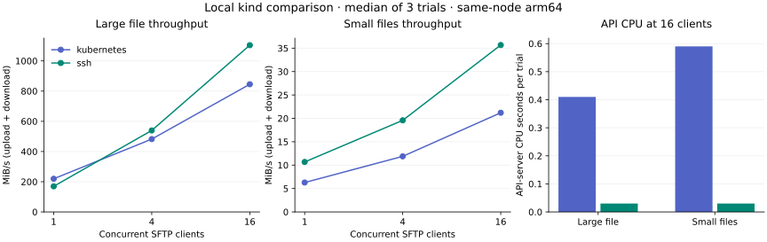

# Backend benchmark: disposable kind cluster

Measured on 2026-10-31 using `scripts/benchmark-backends.sh`. This is a local
comparison of the implemented transports, not a production capacity claim.

## Workload and method

One Docker-backed kind v0.33.0 node runs Kubernetes v1.37.0 on arm64.
The host is an Apple M4 Pro; the Docker VM has 8 vCPUs and about 15.7 GiB RAM.
The test binary was built with Go 1.27.3. The test runner
hosts a real VoidShell SSH server inside the cluster and uses its actual Kubernetes
manager. The test-only authenticator accepts generated test keys; GitHub network
latency is excluded. Both modes use the same minimal Ubuntu 26.04/OpenSSH image,
UID 1000, dropped capabilities, home `emptyDir`, and single retained workspace.
The production Homebrew image is not used. No deployed cluster is modified.

OpenSSH `sftp` clients upload and download either a 16 MiB file or 200 files of
4 KiB each, with 1, 4, and 16 concurrent clients. Each case runs three trials.
Downloaded bytes are verified. Timings include SSH connections, subsystem startup,
transfers, verification, and local download cleanup; provisioning is excluded.
Large-file remote cleanup is included; small-file remote directories are retained
until pod deletion. Reported MiB/s counts upload plus download across all clients.
SSH compression is disabled by default. All Kubernetes cases run before SSH;
caches and ordering are possible confounders.

API CPU is the difference in the API server's `process_cpu_seconds_total` before
and after each trial, including ambient cluster work. RSS is
`process_resident_memory_bytes` at trial end, not peak or isolated incremental
memory. Two-second idle samples consumed 0.12 API CPU seconds in each backend.
CPU is measured in hundredths of a second, so short trials have limited precision.
The metrics requests themselves also use API resources. Medians appear below;
all 38 samples are retained in [the measurement data](benchmarks/2026-10-31-kind.json).

## Results



| Workload | Clients | Kubernetes MiB/s | SSH MiB/s | Kubernetes API CPU seconds | SSH API CPU seconds |
|---|---:|---:|---:|---:|---:|
| Large | 1 | 219.5 | 169.7 | 0.05 | 0.03 |
| Large | 4 | 482.3 | 539.5 | 0.12 | 0.02 |
| Large | 16 | 845.5 | 1104.0 | 0.41 | 0.03 |
| Small | 1 | 6.3 | 10.7 | 0.06 | 0.03 |
| Small | 4 | 11.9 | 19.6 | 0.16 | 0.03 |
| Small | 16 | 21.2 | 35.7 | 0.59 | 0.03 |

At 16 clients, median large-file throughput was 845.5 versus 1104.0 MiB/s, with
0.41 versus 0.03 API CPU seconds. Small-file throughput was 21.2 versus 35.7 MiB/s,
with 0.59 versus 0.03 API CPU seconds. Single-client large-file throughput was
lower with SSH (169.7 versus 219.5 MiB/s); direct SSH adds an internal encryption
and authentication cost and is not uniformly faster.

API-server end-of-trial RSS ranged from 256.3–290.5 MiB during Kubernetes trials
and 292.5–322.7 MiB during SSH trials. Because these share one API-server process,
run sequentially, and include retained Go heap, the data do not establish a
memory reduction. The supported conclusion is lower API CPU during these data
transfers, consistent with removing the API from the data path. Production
availability, cross-node/network latency, peak memory, and sustained overload
remain unmeasured. Keep Kubernetes as the default and rerun on representative
hardware before changing deployment defaults.

## Reproduce

Requirements: Docker, kind, kubectl, Go matching `go.mod`, and Bash. The script
builds a minimal OpenSSH workspace and Linux test runner, creates a new kind
cluster with a private temporary kubeconfig, loads both images, runs the matrix,
and removes the cluster on exit. It leaves the configured cluster untouched.

```sh
./scripts/benchmark-backends.sh /tmp/voidshell-backends.log
```

The disposable namespace grants pod lifecycle, Secret get/create, exec, and API
metrics read to a test-only ServiceAccount. The fixture manifest is not intended
for a deployed cluster. Default kind networking does not enforce NetworkPolicy;
chart manifests were additionally validated by Kubernetes server dry-run, but
CNI policy enforcement needs a smoke check on an enforcing cluster.

For the protocol/security suite without Kubernetes:

```sh
docker build -f internal/k8s/testdata/Dockerfile.ssh-test -t voidshell-sshd:test .
VOIDSHELL_TEST_SSH_IMAGE=voidshell-sshd:test \
  go test -race ./internal/k8s -run TestDirectSSHOpenSSH -v -timeout 60s
```

This requires local TCP 2222 to be free. Tests cover host-key mismatch, wrong
client credentials, image PATH, command stdout/stderr and exit status, PTY shell,
resize, signals, binary SFTP/legacy SCP, 16 concurrent channels, workspace-loopback
forwarding, and rejection of arbitrary cluster destinations. Unit tests cover
credential ownership, rotation references, projection of public authentication
keys only, endpoint-cache lifetime, handshake cancellation, and request filtering.
CI runs the Docker/OpenSSH suite in addition to the normal Go and Helm checks.
